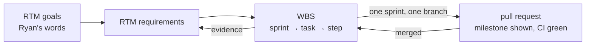

# development/

How I2S is planned, tracked and verified while it is a private draft. The
specification's own rules (append-only, the schema, the witness) are in
[CONTRIBUTING.md](../CONTRIBUTING.md); this folder breaks the work down into
sprints, tasks and requirements.

| File | Use it to… |
|---|---|
| [WBS.md](WBS.md) | track the work sprint by sprint: each sprint's milestone and pull request, its tasks and their red-first steps, each tick with its evidence; the decisions and the open questions |
| [RTM.md](RTM.md) | trace each requirement back to Ryan's goals and forward to code and tests, with status |
| [style_guide.md](style_guide.md) | the binding conventions for code, plans and prose |
| [ci_runners.md](ci_runners.md) | the rules every workflow follows: when a runner runs, reuse, caches, robustness |

## How a sprint runs

A sprint is one work package of the WBS: a few days of work that ends in a
milestone someone can see working, and one pull request.

1. The branch is named after the sprint (`feature/SpecScaffold_1`), chosen
   before the first push, since renaming a pull request's head branch closes
   the pull request.
2. Each task starts with a test shown red, recorded with its failure; then the
   code that turns it green, with the evidence (test counts, the command run).
3. The milestone is demonstrated: a command anyone can run, and its output.
4. The sprint ends with a **VERIFY** step for Ryan and a **Gate** step: CI
   green on the pull request. Nothing from the next sprint is started on the
   same branch.

The pull request's description has these sections, in this order: Summary ·
WBS (the sprint's tasks, ticked, with evidence and commit links) · RTM (rows
changed, with evidence) · Decisions (dated, with Ryan's words) · Measurements
(when any were taken) · Test results (per cell, local and CI) · Red first ·
Failures fixed (symptom, root cause, fix, commit) · Clinical impact (what a
pathologist would see differently) · Security impact (new input parsed? new
dependency? patient data in the diff, logs or fixtures?).

**Naming:** every ID says what it is. A WBS item is `PascalCaseName_<number>`
(`VocabularyFromScanners_2`, `PhiFlag_1.6`); an RTM row is
`PascalCaseArea_<nn>` (`AppendOnly_01`); a goal is `Goal_<nn>`. No
abbreviations.

**Update rule:** a commit that changes code updates the WBS steps it completes
and the RTM rows it touches, in the same commit, and the step names the
commit once it exists. Commits are staged by explicit path.
