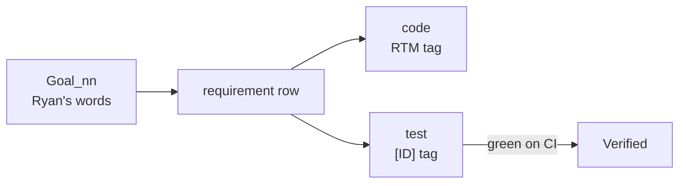

# Requirements Traceability Matrix

Every requirement traces back to the goal it serves and forward to the code
that satisfies it and the tests that prove it. A requirement is **Verified**
only when its tests run green on CI; code with tests green locally is
**Implemented**.

- **Source:** `Goal_nn` (below) or a [WBS](WBS.md) decision.
- **Sprint:** the WBS sprint that delivers the row.
- **Status:** Planned → Implemented → Verified (or Partial / Blocked, with a
  note); Retired when Ryan drops it (the ID is never reused).
- **Tests:** `Unit` (pytest) · `Static` (a `static_assert`, a compile-fail
  test, or a gate that reads the source) · `Contract` (a generated table's
  promise, checked from C++).
- **Tags:** a comment line `// RTM <ID>[, <ID>…]` (C++) or `# RTM <ID>[, <ID>…]`
  (Python, CMake, workflows) on the code and the test; Catch2 tests also carry
  the tag `[<ID>]`.

## Goals

| Goal | Ryan's words (2026-11-24) |
|---|---|
| Goal_01 | "We will need to make a I2S repo as well … the information that goes into the slide when it is initially scanned by different scanners (acessioning number, stain info, time, date, scanner info like unique device ID). These are the things that need to go into I2S because they're indelible characteristics of the slide and not patient HL7 metadata." |
| Goal_02 | "We'll call the accessioning number DigitalSlideIdentifier(DSI)" |
| Goal_03 | "let's have I2S be a JSON specification that gets compiled into C++ source like the IFE" |
| Goal_04 | "We can add in the description that DSI has a separate DSI_is_PHI:bool so we know if it needs to be scrambled during deidentification" · "Absent flag should default to true, scramble it" |
| Goal_05 | "We should be using blacksmith for our CI runners" |

## Requirements

| ID | Requirement | Source | Sprint | Code | Tests | Status |
|---|---|---|---|---|---|---|
| Schema_01 | Every key states its name, short name, DICOM counterpart (or none, where I2S diverges), value type, multiplicity, identity class, PHI flag and description; every field present, null where it does not apply; unknown fields refused | Goal_01, Goal_03 | SpecScaffold_1 | `spec/i2s_keys.json`, `generator/model.py` | Unit: `test_unknown_value_type_is_rejected`, `test_committed_spec_passes` | Verified |
| AppendOnly_01 | A removed or changed key, value type or identity class fails generation, naming the fact and both values; additions pass and must be recorded in the witness before `--check` passes; only an `UNDER_REVIEW` identity class may change | Goal_03 | SpecScaffold_1 | `generator/validate.py`, `generator/witness.py`, `tests/witness/witness.json` | Unit: `test_removed_key_is_rejected`, `test_retyped_key_is_rejected`, `test_added_key_passes_as_a_note`, `test_identity_under_review_may_be_decided` | Verified |
| UniqueNames_01 | A name is defined once: a repeated name in one JSON object, a key in two version groups, or a short name equal to another name is refused | Goal_03 | SpecScaffold_1 | `generator/pipeline.py`, `generator/model.py` | Unit: `test_duplicate_name_in_one_object_is_rejected`, `test_duplicate_name_across_version_groups_is_rejected`, `test_short_name_equal_to_a_key_name_is_rejected` | Verified |
| Generated_01 | `I2S::key_from_name` returns the key for its name or short name, and `std::nullopt` for any other text | Goal_03 | SpecScaffold_1 | `generator/emit/cpp.py` | Static: `[Generated_01]` | Verified |
| Generated_02 | Every key has a value type and an identity class from the generated enumerations | Goal_03 | SpecScaffold_1 | `generator/emit/cpp.py` | Static: `[Generated_02]` | Verified |
| Generated_03 | The DSI is `DigitalSlideIdentifier`, short name `DSI`, with no DICOM attribute; scanner keys carry their verified DICOM tags | Goal_01, Goal_02 | SpecScaffold_1 | `spec/i2s_keys.json` | Static: `[Generated_03]` | Verified |
| Generated_04 | A key's old name fails to compile after a rename | Goal_03 | SpecScaffold_1 | `generator/emit/cpp.py` | Static: `i2s_renamed_key_fails_to_compile` | Verified |
| PhiFlag_01 | A key may name a BOOLEAN flag key stating per file whether its value is PHI; a flag naming no key or a key that is not BOOLEAN is refused; the DSI's flag is `DSI_is_PHI` | Goal_04 | SpecScaffold_1 | `generator/model.py`, `generator/emit/cpp.py` | Unit: `test_phi_flag_must_name_a_boolean_key`, `test_phi_flag_must_name_a_defined_key`; Static: `[PhiFlag_01]` | Verified |
| PhiFlag_02 | When the DSI is present and `DSI_is_PHI` is absent, a reader and a de-identifier treat the DSI as PHI; the default is witnessed and generated as `PhiFlag::absent_means_phi` | Goal_04 | SpecScaffold_1 | `spec/i2s_keys.json`, `generator/emit/cpp.py` | Unit: `test_changed_absent_default_is_rejected`; Static: `[PhiFlag_02]` | Verified |
| Document_01 | A readable specification document is generated from the same JSON, byte-stable | Goal_03 | SpecScaffold_1 | `generator/emit/docs.py` | Unit: `test_generation_is_deterministic` | Verified |
| Process_01 | Work runs in sprints that each end in a milestone and one pull request, every task red first | Goal_03 | SpecScaffold_1 | `development/` | review | Implemented |
| Ci_01 | CI runs the generator's checks and `ctest` on non-draft pull requests on Blacksmith, pinned and bounded | Goal_05 | SpecScaffold_1 | `.github/workflows/ci.yml` | the workflow's own run (45429051380) | Verified |
| Vocabulary_01 | The scan-time vocabulary (stain, scan date and time, optics, resolution) | Goal_01 | VocabularyFromScanners_2 | — | — | Planned |
| Identity_01 | No key a release depends on is `UNDER_REVIEW` | Goal_01, Goal_04 | IdentityClasses_3 | — | — | Blocked (Open questions 1–3) |
| Adoption_01 | IFE's `METADATA_I2S` names I2S; Iris-Slide refuses attribute keys I2S does not define | Goal_01 | IfeAndIrisSlideAdoption_4 | — | — | Planned |
