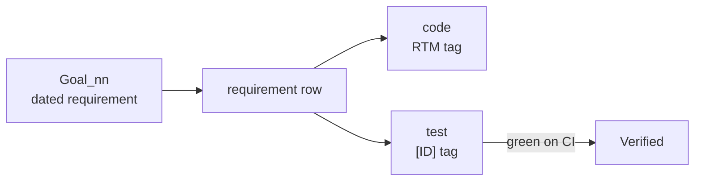

# Requirements Traceability Matrix

Every requirement traces back to the goal it serves and forward to the code
that satisfies it and the tests that prove it. A requirement is **Verified**
only when its tests run green on CI; code with tests green locally is
**Implemented**.

- **Source:** `Goal_nn` (below) or a [WBS](WBS.md) decision.
- **Sprint:** the WBS sprint that delivers the row.
- **Status:** Planned → Implemented → Verified (or Partial / Blocked, with a
  note); Retired when the maintainer drops it (the ID is never reused).
- **Tests:** `Unit` (pytest) · `Static` (a `static_assert`, a compile-fail
  test, or a gate that reads the source) · `Contract` (a generated table's
  promise, checked from C++).
- **Tags:** a comment line `// RTM <ID>[, <ID>…]` (C++) or `# RTM <ID>[, <ID>…]`
  (Python, CMake, workflows) on the code and the test; Catch2 tests also carry
  the tag `[<ID>]`.

## Goals

| Goal | Requirement (2026-11-24) |
|---|---|
| Goal_01 | A repository for I2S holds the facts a slide is given when it is scanned, by any scanner: the laboratory's accession identifier, stain, date and time of the scan, and the scanner's identity down to its unique device identifier. They are indelible characteristics of the slide, kept apart from the patient's HL7 or FHIR metadata |
| Goal_02 | The accession identifier is a named key with a short name (`DigitalImageIdentifier`, `DII`, after Decision_06) |
| Goal_03 | I2S is a JSON specification compiled into C++ source, as IFE is |
| Goal_04 | The identifier has a BOOLEAN flag (`DII_is_PHI`) stating whether it must be scrambled during de-identification; an absent flag means it is PHI and is scrambled |
| Goal_05 | CI runs on Blacksmith runners |
| Goal_06 | A linter checks the current version of I2S: formatting, times, versions, and that nothing is dropped |
| Goal_07 | An AsciiDoc document is generated from the specification, as IFE's is, for a person to review |
| Goal_08 | No public file quotes a person |
| Goal_09 | A scanner vendor's developer writes I2S attributes in C++ with IDE completion and compile-time type checking, each value encoded as its DICOM VR, and a viewer lists a file's I2S attributes in one loop; I2S defines the vocabulary and IFE's attribute block the container |

## Requirements

| ID | Requirement | Source | Sprint | Code | Tests | Status |
|---|---|---|---|---|---|---|
| Schema_01 | Every key states its name, short name, DICOM counterpart (or none, where I2S diverges), value type, multiplicity, identity class, PHI flag and description; every field present, null where it does not apply; unknown fields refused | Goal_01, Goal_03 | SpecScaffold_1 | `spec/i2s_keys.json`, `generator/model.py` | Unit: `test_unknown_value_type_is_rejected`, `test_committed_spec_passes` | Verified |
| AppendOnly_01 | A removed or changed key, value type or identity class fails generation, naming the fact and both values; additions pass and must be recorded in the witness before `--check` passes; only an `UNDER_REVIEW` identity class may change | Goal_03 | SpecScaffold_1 | `generator/validate.py`, `generator/witness.py`, `tests/witness/witness.json` | Unit: `test_removed_key_is_rejected`, `test_retyped_key_is_rejected`, `test_added_key_passes_as_a_note`, `test_identity_under_review_may_be_decided` | Verified |
| UniqueNames_01 | A name is defined once: a repeated name in one JSON object, a key in two version groups, or a short name equal to another name is refused | Goal_03 | SpecScaffold_1 | `generator/pipeline.py`, `generator/model.py` | Unit: `test_duplicate_name_in_one_object_is_rejected`, `test_duplicate_name_across_version_groups_is_rejected`, `test_short_name_equal_to_a_key_name_is_rejected` | Verified |
| Generated_01 | `I2S::key_from_name` returns the key for its name or short name, and `std::nullopt` for any other text | Goal_03 | SpecScaffold_1 | `generator/emit/cpp.py` | Static: `[Generated_01]` | Verified |
| Generated_02 | Every key has a value type and an identity class from the generated enumerations | Goal_03 | SpecScaffold_1 | `generator/emit/cpp.py` | Static: `[Generated_02]` | Verified |
| Generated_03 | The accession identifier is `DigitalImageIdentifier`, short name `DII`, with no DICOM attribute; scanner keys carry their verified DICOM tags | Goal_01, Goal_02 | SpecScaffold_1 | `spec/i2s_keys.json` | Static: `[Generated_03]` | Verified |
| Generated_04 | A key's old name fails to compile after a rename (the test names `DigitalSlideIdentifier`, renamed 2026-11-24) | Goal_03 | SpecScaffold_1 | `generator/emit/cpp.py` | Static: `i2s_renamed_key_fails_to_compile` | Verified |
| PhiFlag_01 | A key may name a BOOLEAN flag key stating per file whether its value is PHI; a flag naming no key or a key that is not BOOLEAN is refused; the DII's flag is `DII_is_PHI` | Goal_04 | SpecScaffold_1 | `generator/model.py`, `generator/emit/cpp.py` | Unit: `test_phi_flag_must_name_a_boolean_key`, `test_phi_flag_must_name_a_defined_key`; Static: `[PhiFlag_01]` | Verified |
| PhiFlag_02 | When the DII is present and `DII_is_PHI` is absent, a reader and a de-identifier treat the DII as PHI; the default is witnessed, generated as `PhiFlag::absent_means_phi`, and applied by `I2S::is_phi` | Goal_04 | SpecScaffold_1, TypedAttributes_3 | `spec/i2s_keys.json`, `generator/emit/cpp.py`, `include/I2S_Attributes.hpp` | Unit: `test_changed_absent_default_is_rejected`; Static: `[PhiFlag_02]`; Contract: `i2s_attributes_tests` `[PhiFlag_02]` | Verified |
| Document_01 | A readable specification document is generated from the same JSON, byte-stable | Goal_03 | SpecScaffold_1 | `generator/emit/docs.py` | Unit: `test_generation_is_deterministic` | Retired 2026-11-24: the Markdown document is replaced by Document_02 |
| Process_01 | Work runs in sprints that each end in a milestone and one pull request, every task red first; no public file quotes a person | Goal_03, Goal_08 | SpecScaffold_1 | `development/` | review | Implemented |
| Ci_01 | CI runs the generator's checks and `ctest` on non-draft pull requests on Blacksmith, pinned and bounded | Goal_05 | SpecScaffold_1 | `.github/workflows/ci.yml` | the workflow's own run (45429051380) | Verified |
| Lint_01 | Each spec file is in canonical form (schema field order, two-space indent, trailing newline, no duplicate names); `--validate` names the file and line, `--fix` rewrites it | Goal_06 | SpecLintAndDocument_2 | `generator/validate.py`, `generator/pipeline.py` | Unit: `test_lint.py` format tests | Verified |
| Lint_02 | Key names are ASCII PascalCase, short names letters, digits and underscores, every name unique; failures name the file | Goal_06 | SpecLintAndDocument_2 | `generator/model.py` | Unit: `test_lint.py` name tests | Verified |
| Lint_03 | DICOM tags are `GGGG,EEEE` hexadecimal, VRs one of PS3.5's 34, every source a title, an https URL and an ISO 8601 read date | Goal_06 | SpecLintAndDocument_2 | `generator/model.py` | Unit: `test_lint.py` DICOM tests | Verified |
| Lint_04 | Every date is an ISO 8601 calendar date; every value type's example passes its lexical rule; a DATE_TIME carries a UTC offset, with its range and precision stated | Goal_06 | SpecLintAndDocument_2 | `generator/model.py`, `spec/i2s_keys.json` | Unit: `test_lint.py` time tests | Verified |
| Lint_05 | The header version and status are the newest revision's; revisions follow without gap or repeat, only the newest a draft; every version group a revision; nothing added under an older or ratified version | Goal_06 | SpecLintAndDocument_2 | `generator/model.py`, `generator/validate.py` | Unit: `test_lint.py` version tests | Verified |
| Lint_06 | `identity_note` exactly when `UNDER_REVIEW`; PHI flags name BOOLEAN keys; multiplicity in an allowed form | Goal_06 | SpecLintAndDocument_2 | `generator/model.py` | Unit: `test_lint.py` consistency tests | Verified |
| AppendOnly_02 | The gate also refuses a key moved between version groups, a short name removed, a key un-deprecated, and a PHI flag removed or changed | Goal_06 | SpecLintAndDocument_2 | `generator/validate.py`, `generator/witness.py` | Unit: `test_lint.py` dropped-fact tests | Verified |
| Document_02 | An AsciiDoc document, a hand-written narrative including generated tables and key sections with DO-NOT-EDIT banners, renders to HTML and PDF with no warning, no missing or printed include and no table left out | Goal_07 | SpecLintAndDocument_2 | `spec/i2s_spec.adoc`, `generator/emit/docs.py`, `cmake/render_document.cmake` | Unit: `test_document.py`; Static: `i2s_document_refuses_*`, `i2s_document` | Verified |
| Gates_01 | One entry point runs the linter, the generator check, the tests and the document render, in that order, locally and in CI | Goal_06, Goal_07 | SpecLintAndDocument_2 | `CMakePresets.json`, `tests/CMakeLists.txt` | Static: `cmake --workflow --preset gates` | Verified |
| Ci_02 | CI runs the gates on Blacksmith and uploads the rendered HTML and PDF | Goal_05, Goal_07 | SpecLintAndDocument_2 | `.github/workflows/ci.yml` | the workflow's own run (45439828880) | Verified |
| Encoding_01 | Every value is text encoded as its DICOM VR, within the VR's limits, repertoire and multiplicity; every key states a VR legal for its value type and equal to its DICOM attribute's | Goal_09 | TypedAttributes_3 | `spec/i2s_keys.json`, `generator/model.py`, `include/I2S_Attributes.hpp` | Unit: `test_encoding.py`; Contract: `i2s_attributes_tests` `[Encoding_01]` | Verified |
| TypedKeys_01 | Every key and short name is a typed C++ constant with IDE documentation; a value of the wrong type fails to compile, naming the concept it failed | Goal_09 | TypedAttributes_3 | `generator/emit/cpp.py`, `include/I2S_Attributes.hpp` | Static: `i2s_compile_fail_*`, `[TypedKeys_01]` | Verified |
| Adapter_01 | `I2S::Attributes` converts only to and from IFE's (key name, value text) pairs; a refused write or pair names the key, the text and the rule | Goal_09 | TypedAttributes_3 | `include/I2S_Attributes.hpp` | Contract: `[Adapter_01]` | Verified |
| Iteration_01 | `I2S::Attributes` is a forward range of elements in the spec's key order, the same written or read | Goal_09 | TypedAttributes_3 | `include/I2S_Attributes.hpp` | Static and Contract: `[Iteration_01]` | Verified |
| Readme_01 | The README's C++ examples compile and run as a test | Goal_09 | TypedAttributes_3 | `cmake/readme_examples.cmake` | Static: `i2s_readme_examples` | Verified |
| PythonAttributes_01 | A typed Python module and stubs for the same vocabulary and text | Goal_09 | PythonAttributes_4 | — | — | Planned |
| Vocabulary_01 | The scan-time vocabulary (stain, scan date and time, optics, resolution) | Goal_01 | VocabularyFromScanners_5 | — | — | Planned |
| Identity_01 | No key a release depends on is `UNDER_REVIEW` | Goal_01, Goal_04 | IdentityClasses_6 | — | — | Blocked (Open questions 1–3) |
| Adoption_01 | IFE's `METADATA_I2S` names I2S; Iris-Slide refuses attribute keys I2S does not define | Goal_01 | IfeAndIrisSlideAdoption_7 | — | — | Planned |
