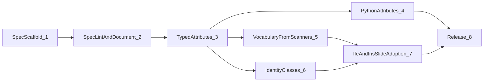

# Work Breakdown Structure

The tracking sheet for I2S's work, written top down: each **sprint** states
its purpose and the **milestone** that shows it done; each **task** states
what it achieves and the RTM rows it serves in brackets; the **steps** under
it are the checkable implementation, red first. Requirements live in
[RTM.md](RTM.md).

## Conventions

- **A sprint is one work package with its own commits and its own section
  here.** It is sized to a few days *(estimate, not measured)*, ends in a
  milestone that can be run and seen, and closes with **VERIFY** (the
  maintainer reviews) and **Gate** (CI green on the pull request).
- **One branch and one pull request per repository** (Decision_08): until it
  merges, every sprint is committed to `feature/SpecScaffold_1` and lands
  through pull request #1, whose description lists the sprints in order. No
  pull request is stacked on another. [README.md](README.md) gives the pull
  request's sections.
- **Red first.** A task's first step is the test shown failing, with its
  failure quoted; the task is ticked only with the green evidence and the
  commit that made it.
- **Status** after a sprint's name: `todo`, `ready` (its dependencies are
  merged), `doing`, `blocked` (with the reason), `done`.
- **One tick, one piece of evidence:** test counts and the command, a
  measurement, or a reviewed document; and the commit, once it exists.

## Sprint plan



| Sprint | Milestone (what is shown working) | Status |
|---|---|---|
| SpecScaffold_1 | `ctest` green on a header generated from `spec/*.json`; the generator refuses a removed key, a retyped key and a duplicate name | `doing` (PR #1 open, carrying every sprint) |
| SpecLintAndDocument_2 | `cmake --workflow --preset gates` runs the linter, the generator check, the tests and the AsciiDoc render, locally and on CI, and CI publishes the HTML and PDF | `doing` (in PR #1, CI green) |
| TypedAttributes_3 | a vendor's C++ writes `attributes[I2S::ScanTime] = std::chrono::system_clock::now();` with completion and compile-time type checking; every value encoded as its DICOM VR; `I2S::Attributes` iterates, and adapts to and from IFE's attribute pairs | `doing` (in PR #1) |
| PythonAttributes_4 | `attributes[I2S.ScanTime] = datetime.now(timezone.utc)` type-checks under mypy --strict from generated stubs, a naive datetime is refused at run time, and `Attributes` iterates | `todo` |
| VocabularyFromScanners_5 | the keys every scanner family writes at scan time (stain, scan date and time, optics, resolution) generated and tested, each DICOM mapping verified | `todo` |
| IdentityClasses_6 | every key's identity class decided by the maintainer; no key left `UNDER_REVIEW` that a release depends on | `blocked` on the maintainer's answers (Open questions) |
| IfeAndIrisSlideAdoption_7 | IFE's `METADATA_I2S` text points to I2S; Iris-Slide refuses an attribute key the generated header does not define | `todo` |
| Release_8 | a licence chosen, version 1.0 ratified, the repository public | `blocked` on the licence |

## SpecScaffold_1 — the specification compiles into C++ `doing`

Purpose: I2S is a JSON specification compiled into C++ source, as IFE is
(decided 2026-11-24). Milestone: `cmake --preset debug &&
cmake --build --preset debug && ctest --preset debug` green on a header
generated at configure from `spec/*.json`, and `uv run pytest` showing the
generator refuse a removed key, a retyped key and a duplicate name. Branch
`feature/SpecScaffold_1`.

- [x] **ReadmeOnMain_1.1** — `README.md` on `main`: what I2S is, its goals,
  draft and private. Commit 2e7f472
- [x] **KeySchema_1.2** — `spec/i2s_header.json` (version 0.1, draft,
  revisions) and `spec/i2s_keys.json` (value types, identity classes, keys,
  each grouped by version as IFE's spec is); seven keys seeded, each DICOM
  keyword, tag and VR read from PS3.6 2026e and the PS3.3 2026e modules on
  2026-11-24, the URLs recorded in each key's `verified` [Schema_01]. Commit 09cc501
- [x] **GeneratorGate_1.3** — `generator/` parses the JSON into frozen
  dataclasses, refusing unknown fields, unknown references, a name repeated in
  one JSON object or across version groups, and a short name equal to another
  key's name; the append-only gate compares the witness with
  `tests/witness/witness.json` [AppendOnly_01, UniqueNames_01]
  - [x] Red: `uv run pytest` before `generator/` existed: `ModuleNotFoundError:
    No module named 'generator'`
  - [x] Green: `uv run pytest`: 10 passed; `uv run mypy` (strict,
    `disallow_any_explicit`): no issues in 10 source files. Commit 09cc501
- [x] **GeneratedHeader_1.4** — `emit/cpp.py` writes `I2S_Keys.hpp`: scoped
  enumerations `Key`, `ValueType`, `IdentityClass`; the `constexpr` table
  `kKeys` indexed by `Key` (a `static_assert` holds the index); lookups
  returning `std::optional`. CMake's INTERFACE target `i2s` runs the generator
  at configure; Catch2 v3.16.1 pinned by archive hash [Generated_01,
  Generated_02, Generated_03]
  - [x] Red: built before CMake ran the generator: `keys_tests.cpp:5:10:
    fatal error: 'I2S_Keys.hpp' file not found`
  - [x] Green: `ctest --preset debug`: 6 of 6 passed. Commit 09cc501
- [x] **RenameBreaksBuild_1.5** — ctest builds `tests/cpp/renamed_key.cpp`,
  which names `I2S::Key::AccessionNumber`, and passes only when the compiler's
  error names it [Generated_04]
  - [x] Control: the same file naming `Key::Manufacturer` compiles, and the
    test fails: `Required regular expression not found`
  - [x] Green: `error: no member named 'AccessionNumber' in 'I2S::Key'`; test
    passed. Commit 09cc501
- [x] **PhiFlag_1.6** — `DigitalSlideIdentifierIsPHI` (`DSI_is_PHI`, BOOLEAN,
  identity `NONE`) and the key field `phi_flag` with `absent_means_phi`; the
  generator refuses a flag that names no key or a key that is not BOOLEAN; the
  generated `PhiFlag{Key::DigitalSlideIdentifierIsPHI, true}` carries the
  absent default [PhiFlag_01, PhiFlag_02]
  - [x] Red: `uv run pytest`: 3 failed, `unknown field(s) ['phi_flag']`; the
    C++ build: `error: no member named 'phi_flag' in 'I2S::KeyInfo'`
  - [x] Green: `uv run pytest`: 13 passed; `ctest --preset debug` and
    `--preset release`: 7 of 7 passed. Commit 09cc501
- [x] **GeneratedDocument_1.7** — `emit/docs.py` writes
  `generated_docs/i2s_specification.md` with the revision history, value
  types, identity classes, a key table and a section per key; byte-stable,
  checked by `test_generation_is_deterministic` [Document_01]. Commit 09cc501
- [x] **DevelopmentFolder_1.8** — this folder: README, WBS, RTM,
  `style_guide.md` (adapted from Iris-Slide's copy), `ci_runners.md`;
  `CONTRIBUTING.md` at the root [Process_01]. Commit 7204884
- [x] **CiWorkflow_1.9** — `.github/workflows/ci.yml` on Blacksmith's
  `blacksmith-2vcpu-ubuntu-2404` (every CI job runs on Blacksmith, decided
  2026-11-24): non-draft pull requests and by hand only,
  documentation-only changes skipped, 15-minute timeout, actions pinned by
  commit, uv and `dependencies/` cached [Ci_01]. Commit 7204884
  - [x] Rehearsed locally on macOS: the workflow's configure line, `--check`
    and `ctest --preset release` green. Not rehearsed in a Linux container;
    the first Blacksmith run (45429051380) confirmed the image's CMake and
    Ninja and the GCC-side compile-fail message
- [ ] **VERIFY:** the maintainer reads `spec/i2s_keys.json` and the generated header and
  answers the open questions
- [x] **Gate:** CI green on pull request #1: run 45429051380 on
  `blacksmith-2vcpu-ubuntu-2404`, pytest 13 passed, `--check` current, ctest
  7 of 7, 1 min 20 s

## SpecLintAndDocument_2 — a linted specification, rendered for review `doing` · needs SpecScaffold_1

Purpose: a linter over the current version of I2S that checks the files are
formatted correctly, times are ISO 8601, versions are consistent and nothing
is dropped; and an AsciiDoc document generated from the specification, as
IFE's is, for a person to review (requested 2026-11-24). Milestone: `cmake
--workflow --preset gates` runs the linter, the generator check, the tests and
the document render in that order, locally and on Blacksmith, and CI uploads
the HTML and PDF. Committed to `feature/SpecScaffold_1`, through pull request
#1 (Decision_08); its commits were first pushed as `feature/SpecLintAndDocument_2`
with pull request #2, which is left to be closed.

- [x] **DiiRename_2.1** — commit c03ec35. Decision_06: `DigitalImageIdentifier` (`DII`) and
  `DigitalImageIdentifierIsPHI` (`DII_is_PHI`) in place in 0.1; the
  compile-fail test names the old `Key::DigitalSlideIdentifier`
  [Generated_03, Generated_04, PhiFlag_01]
  - [x] Red: the gate refused the rename, `generator: REMOVED
    keys.DigitalSlideIdentifier` and `REMOVED keys.DigitalSlideIdentifierIsPHI`;
    `uv run pytest`: 7 failed; `--refresh-witness` refused the same way
  - [x] Green after the two old entries were deleted from the witness by hand
    and the new ones recorded: `uv run pytest` 13 passed, `ctest --preset
    debug` 7 of 7, the compile-fail test matching `error: no member named
    'DigitalSlideIdentifier' in 'I2S::Key'`
- [x] **NoQuotes_2.2** — commit c03ec35. Decision_07 across README, CONTRIBUTING, the spec,
  `development/` and the workflow; pull request #1's body rewritten [Process_01]
  - [x] `grep -rni ryan` over the public files finds only the author line in
    `spec/i2s_header.json`
- [x] **CanonicalFormat_2.3** — commit 377370b. `--validate` fails on a spec file that is not
  in canonical form, naming the file and the first differing line; `--fix`
  rewrites it (schema field order, two-space indent, trailing newline) [Lint_01]
  - [x] Red: `--validate` returned 0 on a re-indented file, one without its
    trailing newline, and one with fields out of schema order (`assert 0 == 1`)
  - [x] Green: `test_lint.py` format tests pass; `--fix` restores the
    committed text byte for byte
- [x] **NameRules_2.4** — commit 377370b. PascalCase key names, unique short names, ASCII
  names; every failure now names its file [Lint_02]
  - [x] Red: the rules existed since 09cc501, but their messages named no
    file: `keys.manufacturer_name: 'manufacturer_name' is not a PascalCase
    name` without `spec/i2s_keys.json:`
  - [x] Green: three name tests pass
- [x] **DicomRules_2.5** — commit 377370b. tags `GGGG,EEEE`, VRs from DICOM's 34 (PS3.5
  2026e Table 6.2-1, read 2026-11-24), `verified` now a list of sources, each
  a title, an https URL and an ISO 8601 read date [Lint_03]
  - [x] Red: an unknown VR `XX` passed (`DID NOT RAISE SpecError`);
    `verified` was free text, so no date or URL could be checked
  - [x] Green: four DICOM tests pass
- [x] **TimeRules_2.6** — commit 377370b. revision dates and `verified` dates are ISO 8601
  calendar dates; each value type carries an `example` checked by its lexical
  rule; a DATE_TIME requires a UTC offset between -12:00 and +14:00, to the
  second with up to six fractional digits, from 0001-01-01 to 9999-12-31, as
  its description and the document state [Lint_04]
  - [x] Red: `value_types.DATE_TIME: unknown field(s) ['example']`, so a time
    without an offset could not be checked; revisions had no date
  - [x] Green: `test_date_time_without_offset_is_refused` fails as intended
    with `'2026-11-24T10:30:00' is not a DATE_TIME: it has no UTC offset`;
    four time tests pass
- [x] **VersionRules_2.7** — commit 377370b. the header version and status are the newest
  revision's; revisions follow without gap or repeat and only the newest may
  be a draft; every version group is a revision; nothing is added under an
  older version or a ratified one [Lint_05]
  - [x] Red: a header at 0.2 with only a 0.1 revision, a gap 0.1→0.3, a
    repeated 0.1, two drafts, a 0.0 group and a key added to 0.1 under 0.2 all
    passed
  - [x] Green: eight version tests pass
- [x] **NothingDropped_2.8** — commit 377370b. the gate's missing cases: a key moved between
  version groups, a short name removed, a key un-deprecated, a PHI flag
  removed or its absent default changed [AppendOnly_02]
  - [x] Red: un-deprecating passed, since `deprecated` was not witnessed; a
    move between groups could not be expressed (the version rules above)
  - [x] Green: `deprecated` witnessed, settable and never cleared; five
    dropped-fact tests pass (short name and PHI flag removal were already
    caught as `CHANGED`, now tested)
- [x] **Consistency_2.9** — commit 377370b. `identity_note` exactly when `UNDER_REVIEW`; PHI
  flags name BOOLEAN keys; multiplicity in an allowed form [Lint_06]
  - [x] Red: the rules existed since 09cc501; their messages named no file
  - [x] Green: eight consistency tests pass (six multiplicity forms)
- [x] **AsciiDocDocument_2.10** — commit 377370b. `spec/i2s_spec.adoc` narrative (purpose,
  identity rules, the DII and its flag, the absent-means-PHI rule, value types,
  how keys are added) and six generated includes with IFE's `////` banner and
  the witness hash, in place of the Markdown document; generation deletes
  orphaned outputs and `--check` fails on them; `cmake/render_document.cmake`
  renders HTML and PDF with `--failure-level=WARN` and IFE's guards against a
  missing include, an include printed as text and a table never included
  [Document_02]
  - [x] Red: `test_document.py`: the narrative did not exist
    (`FileNotFoundError`) and the stale `i2s_specification.md` survived
    generation; plain `asciidoctor` exited 0 on all three broken narratives in
    `tests/document/`
  - [x] Green: three document tests pass; each broken narrative fails the
    render with its own guard (`render_document[unprocessed-include]`,
    `[asciidoctor-failed]`, `[unincluded-file]`); control: a wrong expected
    guard fails the test (`Required regular expression not found`)
- [x] **Gates_2.11** — commit 377370b. one entry point, `cmake --workflow --preset gates`:
  configure (the generator), build, then ctest in a fixed `DEPENDS` order:
  `i2s_lint`, `i2s_generator_check`, the tests, the three document guards,
  `i2s_document` [Gates_01]
  - [x] Green locally (macOS, AppleClang, Ruby 4.0.10): 10 of 10, the render
    writing `build/release/doc/i2s_spec.html` and `.pdf`
- [x] **CiDocument_2.12** — commit 377370b. CI runs `cmake --workflow --preset gates` as a
  single step after the toolchain steps (uv, Ruby with `bundler-cache` from
  `Gemfile.lock`), and uploads `build/release/doc/` as the artifact
  `i2s-specification` [Ci_02]
- [ ] **VERIFY:** the maintainer reads the rendered document (CI artifact
  `i2s-specification`)
- [x] **Gate:** CI green on pull request #2 (since moved onto pull request #1): run 45439828880 on
  `blacksmith-2vcpu-ubuntu-2404`, Ruby 4.0.9, gates 10 of 10, artifact
  `i2s-specification` (HTML and PDF, 68 164 bytes) uploaded

## TypedAttributes_3 — typed keys and an adapter for IFE's attribute pairs `doing` · needs SpecLintAndDocument_2

Purpose (requested 2026-11-24): a scanner vendor's developer writes I2S
attributes in C++ with IDE completion and compile-time type checking, and a
viewer lists a file's I2S attributes in one loop. I2S defines the vocabulary
(each key's name, short name, value type, DICOM VR, the text encoding of a
value under that VR, its limits, identity class and the PHI flag rule); IFE's
ATTRIBUTES block defines the container, so I2S defines no wire format, byte
layout or separator between pairs. Milestone: the README's two examples
compile as tests, a value of the wrong type fails to compile naming the key and
the type, and every value type round-trips through its DICOM text. Committed
to `feature/SpecScaffold_1`, through pull request #1 (Decision_08).

- [x] **DicomEncoding_3.1** — every value is text encoded as its DICOM VR.
  A new `value_representations` section defines CS, DS, DT, IS, LO, LT, SH, ST
  and UT, each with its limit and unit, whether values may be joined by the
  backslash, an example and its source (PS3.5 2026e section 6.2, read
  2026-11-24). Each value type lists its VRs (`TEXT`: SH, LO, ST, LT, UT;
  `DATE_TIME`: DT; `DECIMAL`: DS; `INTEGER`: IS; `BOOLEAN`: CS YES/NO,
  modelled on Burned In Annotation (0028,0301), PS3.3 2026e C.7.6.1). Every
  key has a required, linted `vr`. The DT lexical form (offset required) replaces
  SpecLintAndDocument_2's ISO 8601 form. I2S's limits fit IFE's attribute block
  (16-bit key size, 32-bit value size, UTF-8 `ATTRIBUTE_STRING`), cited in the
  document's Relation to IFE section [Encoding_01]
  - [x] Red: `tests/generator/test_encoding.py` and the DT tests, 13 failed
    (`KeyError: 'vr'`, `DID NOT RAISE`), before the schema had VRs
  - [x] Green: pytest 61 passed; the gate refused the UDI change
    (`CHANGED keys.UniqueDeviceIdentifier.multiplicity: "1-n" -> "1"`),
    recorded by a reviewed hand edit of the witness, since DICOM's UT holds a
    single value
- [x] **TypedKeys_3.2** — one `inline constexpr TypedKey<Key::…>` per key and
  per short name, generated with a Doxygen comment (description, value type,
  VR, multiplicity, DICOM attribute, identity class); a value of the wrong type
  has no viable `operator=`, one per value type, so the note names the concept
  it failed [TypedKeys_01]
  - [x] Red: the first build of the tests, before the adapter existed:
    `fatal error: 'I2S_Attributes.hpp' file not found`
  - [x] Green: four compile-fail tests, each requiring its reason in the
    compiler's output: text to DATE_TIME (`DateTimeValue`; clang: `no viable
    overloaded '='` … `'const char (&)[10]' does not satisfy 'DateTimeValue'`
    for `Slot<I2S::Key::AcquisitionDateTime>`), int to TEXT (`TextValue`), int
    to BOOLEAN (`BooleanValue`), an unknown key (`NoSuchKey`)
- [x] **AttributesAdapter_3.3** — `include/I2S_Attributes.hpp`, header-only:
  typed `set`/`operator[]`/`get`, `to_pairs()` and `from_pairs()` as the only
  conversion, a `Result` naming the key, the text and the rule; a refused write
  is kept in `errors()` and makes `to_pairs()` refuse; no recursion [Adapter_01]
  - [x] Green: `i2s_attributes_tests`, 17 cases, including each VR at its
    limit and one refusal per rule
- [x] **Iteration_3.4** — `begin()`/`end()`, `std::ranges::forward_range`
  (a `static_assert` in the header and in the test), elements with the key,
  name, short name, VR, identity class, text, and a `std::variant` value and
  `visit`, in the spec's key order; attributes read from pairs iterate the same
  [Iteration_01]
- [x] **AbsentFlag_3.5** — `I2S::is_phi(attributes, I2S::DII)` is true when
  `DII_is_PHI` is absent, written or read [PhiFlag_02]
- [x] **ScanTime_3.6** — `AcquisitionDateTime` (0008,002A) DT, short name
  `ScanTime` (PS3.6 2026e; PS3.3 2026e C.7.10.1, read 2026-11-24), identity
  `UNDER_REVIEW`: HIPAA Safe Harbor names date elements other than the year
  (45 CFR 164.514(b)(2)(i)(C)), and PS3.15 2026e Table E.1-1 gives Acquisition
  DateTime the action X/Z/D unless a date option keeps or shifts it (read
  2026-11-24) (Open question 6)
- [x] **ReadmeExamples_3.7** — the README's "Writing attributes" section with
  the two examples, extracted at configure by `cmake/readme_examples.cmake`
  and compiled and run as `i2s_readme_examples`; the document's VR table (one
  example per VR) and Relation to IFE section [Readme_01, Document_02]
  - [x] Red: configure failed, `readme_examples: README.md has no ```cpp
    block`, then `'I2S_Attributes.hpp' file not found`
  - [x] Green: the gates, 16 of 16
- [x] **PythonModule_3.8** — moved to its own sprint, PythonAttributes_4: the
  C++ adapter filled this sprint
- [ ] **VERIFY:** the maintainer writes and lists attributes with the API
- [ ] **Gate:** CI green on the pull request

## PythonAttributes_4 — the same vocabulary, typed in Python `todo` · needs TypedAttributes_3

Purpose (requested 2026-11-24): `attributes[I2S.ScanTime] =
datetime.now(timezone.utc)` type-checks under mypy --strict, and a naive
datetime is refused at run time. Milestone: a generated module and `.pyi`
stubs, as FastFHIR's python_fields does, with `Attributes` iterable and the
same DICOM text as the C++ adapter, checked by a shared round-trip corpus.

- [ ] **PythonKeys_4.1** — a generated module of typed key constants and stubs
- [ ] **PythonAttributes_4.2** — `Attributes` with typed writes and reads,
  `to_pairs`/`from_pairs`, iteration; red: a naive datetime accepted
- [ ] **SharedCorpus_4.3** — the C++ and Python adapters write the same text
  for the same values
- [ ] **VERIFY / Gate**

## VocabularyFromScanners_5 — the scan-time vocabulary `todo` · needs SpecScaffold_1

Purpose: the scan-time facts named on 2026-11-24 (the accession identifier,
stain, date and time of the scan, the scanner's identity down to its unique
device identifier). Milestone: every key below that the maintainer accepts is
in `spec/i2s_keys.json` with its DICOM mapping verified, generated and tested.
Nothing here is added until this sprint.

Keys the research of 2026-11-24 proposes (reports `dicom_wsi.md`,
`philips_3dhistech_roche_others.md`, `leica_aperio_hamamatsu.md`,
`identity_rules.md`; to be moved into this repository's `development/analysis/`
at the start of the sprint):

- **Stain and preparation** (coded, from DICOM's Specimen Preparation Sequence
  content items): staining substance (CID 8112), fixative (CID 8114),
  embedding medium (CID 8115), processing step (CID 8113). Only Olympus
  writes a stain at scan time; the other vendors' files carry none. Needs the
  value type `CODE` and a `code_sets` section, deferred from SpecScaffold_1.
- **Scan date and time:** `AcquisitionDateTime`, with the identity question
  below (dates other than the year are a HIPAA Safe Harbor identifier when
  "directly related to an individual").
- **Image geometry and resolution:** `ImagedVolumeWidth`, `ImagedVolumeHeight`,
  `ImagedVolumeDepth`, `TotalPixelMatrixColumns`, `TotalPixelMatrixRows`,
  `TotalPixelMatrixFocalPlanes`, `PixelSpacing` (microns per pixel),
  `NumberOfFocalPlanes`, `DistanceBetweenFocalPlanes`.
- **Focus and acquisition:** `FocusMethod`, `ExtendedDepthOfField`,
  `AcquisitionDuration`, scan mode, rack and slot position.
- **Optics:** `ObjectiveLensPower`, `ObjectiveLensNumericalAperture`,
  `IlluminationTypeCodeSequence`, illumination wavelength and colour.
- **Compression:** `LossyImageCompression`, its ratio and method.
- **Equipment:** firmware version, last calibration date and status (Philips
  only), `SpatialResolution`.
- **Container and specimen identity** (`ContainerIdentifier`,
  `SpecimenIdentifier`, `BarcodeValue`): the research classes them ambiguous,
  since a laboratory often derives them from the accession number; they go
  with the DII question.

- [ ] **Analysis_5.1** — the research reports kept as written in
  `development/analysis/`
- [ ] **CodeSets_5.2** — the value type `CODE` and a `code_sets` section;
  red: a CODE key without a code set refused
- [ ] **ScanTimeKeys_5.3** — the keys the maintainer accepts, each DICOM mapping
  verified with URL and date
- [ ] **VERIFY:** the maintainer accepts the key list
- [ ] **Gate:** CI green on the pull request

## IdentityClasses_6 — every key's identity decided `blocked` · needs the maintainer's answers

Purpose: a file's I2S attributes promise to identify no individual, so no key
can stay `UNDER_REVIEW` into a release. Milestone: no key a release depends
on is `UNDER_REVIEW`; each decision recorded with its date.

- [ ] **IdentifierIdentity_6.1** — the maintainer answers Open question 1
- [ ] **DeviceIdentity_6.2** — the maintainer answers Open question 2
- [ ] **PromiseAndFlag_6.3** — the maintainer answers Open question 3; IFE's
  `METADATA_I2S` text changes with the answer (IfeAndIrisSlideAdoption_7)
- [ ] **VERIFY:** the maintainer reviews the identity classes
- [ ] **Gate:** CI green on the pull request

## IfeAndIrisSlideAdoption_7 — the file format and the codec use I2S `todo` · needs VocabularyFromScanners_5, IdentityClasses_6

Purpose: I2S is the vocabulary IFE's `METADATA_I2S` names. Milestone: an
Iris-Slide encode refuses, by name, an attribute key that `I2S_Keys.hpp` does
not define, under `METADATA_I2S`.

- [ ] **IfeText_7.1** — IFE's `spec/ife_constants.json` `METADATA_I2S`
  description points to this specification and its version (a pull request
  on IFE)
- [ ] **IrisSlideAllowlist_7.2** — Iris-Slide consumes the `i2s` CMake target
  by FetchContent at a pinned commit and uses `I2S::key_from_name` as its
  attribute allowlist; red: an encode with a key I2S does not define is
  accepted
- [ ] **VERIFY:** the maintainer encodes a slide and reads its attributes
- [ ] **Gate:** CI green on both pull requests

## Release_8 — public `blocked` · needs every sprint above and the licence

- [ ] **Licence_8.1** — the maintainer chooses the licence (Open question 4)
- [ ] **Ratify_8.2** — version 1.0 ratified in `spec/i2s_header.json`; the
  witness frozen for 1.0
- [ ] **Publish_8.3** — the maintainer makes the repository public
- [ ] **VERIFY / Gate**

## Decisions

| ID | Date | Decision |
|---|---|---|
| Decision_01 | 2026-11-24 | I2S is a JSON specification compiled into C++ source, as IFE is |
| Decision_02 | 2026-11-24 | The accessioning number is a key with a short name and no DICOM keyword (first `DigitalSlideIdentifier` / `DSI`; renamed by Decision_06) |
| Decision_03 | 2026-11-24 | The identifier has a companion BOOLEAN flag telling a de-identifier whether to scramble it |
| Decision_04 | 2026-11-24 | Settled: when the identifier is present and its flag is absent, a reader and a de-identifier shall treat the identifier as PHI and scramble it (`absent_means_phi: true`, witnessed) |
| Decision_05 | 2026-11-24 | CI runs on Blacksmith runners |
| Decision_06 | 2026-11-24 | `DigitalSlideIdentifier` (`DSI`) is renamed `DigitalImageIdentifier` (`DII`) and its flag `DigitalImageIdentifierIsPHI` (`DII_is_PHI`), in place in the unreleased 0.1 group with no deprecated alias; the absent-means-PHI rule is unchanged. The gate still refuses a rename: the witness was refreshed by hand, deleting the two old entries, as the reviewed act that permits this one rename before the first release |
| Decision_07 | 2026-11-24 | No public file quotes a person; goals and decisions are stated as dated requirements, and an owner is "the maintainer". Author lines in the specification header are attribution and stay |
| Decision_08 | 2026-11-24 | One branch and one pull request per repository, with no stacked pull requests: every I2S sprint is committed to `feature/SpecScaffold_1` and lands through pull request #1, each sprint's commits distinct and its WBS section intact |
| Decision_09 | 2026-11-24 | Every attribute value is text, encoded as its DICOM VR (PS3.5 section 6.2): DATE_TIME as DT with its offset, INTEGER as IS, DECIMAL as DS, TEXT as the key's string VR, BOOLEAN as the CS values YES and NO; several values joined by the backslash. I2S defines the vocabulary and the text of a value; IFE's attribute block is the container. `I2S::Attributes` is an iterable adapter to and from IFE's (key name, value text) pairs |

Judgment calls made in SpecScaffold_1 and SpecLintAndDocument_2, for the maintainer's review:

- The identity class of `DeviceSerialNumber` and `UniqueDeviceIdentifier` is
  `UNDER_REVIEW`, against the brief that listed them as clearly identifying
  no person: `identity_rules.md` found DICOM PS3.15's Basic Profile removes
  both unless Retain Device Identity is used, and HIPAA Safe Harbor lists
  device identifiers and serial numbers, 45 CFR 164.514(b)(2)(i)(M) (Open
  question 2).
- The UDI key is named `UniqueDeviceIdentifier` after the DICOM keyword of
  the UDI Macro's attribute (0018,1009), with multiplicity `1-n` because
  DICOM's UDI Sequence holds one item per issuing agency.
- Only an identity class `UNDER_REVIEW` may change under the append-only
  gate; any other changed fact fails, and `--refresh-witness` refuses while
  one does.
- `CODE` and code sets wait for VocabularyFromScanners_5, where the stain
  vocabulary gives them a first user.
- Generated output is gitignored and regenerated at every configure, as in
  IFE; the generator runs at every configure (instead of IFE's run-when-missing
  option) because it rewrites only changed files.
- Catch2 is pinned by release archive and SHA-256 (IFE's tests use no
  framework, so there was no IFE pin to copy).
- Canonical form keeps schema field order rather than alphabetical order, so
  a key reads in the order its table documents; the top level of each document
  keeps its order, since a `// MARK` comment heads the section after it.
- The format check runs in `--validate`, `--check` and `--fix`, and not in the
  configure-time generation, so a hand edit still builds and the gates catch it.
- `deprecated` is witnessed as a boolean (set or not); its reason may be
  reworded.
- The document is rendered through `bundle exec` from a committed
  `Gemfile.lock` (Asciidoctor 2.0.26, Asciidoctor PDF 2.3.27, logger 1.7.0,
  which Ruby 4 no longer loads by default), so a local render and CI's match.
- TypedAttributes_3: the adapter holds each value as its DICOM text, so
  writing validates once and reading cannot fail; a refused write is not
  stored and makes `to_pairs()` refuse, so the README's assignment syntax needs
  no return value to fail loudly. DECIMAL is a double written as the shortest
  text that reads back exactly, refused over 16 bytes. INTEGER accepts only
  integer types no wider than 32 bits, so nothing narrows. DATE_TIME accepts
  any `sys_time` and stores the microsecond it falls in; `zoned_time` is left
  out, since its time zone database is not on every platform. Only `TEXT` keys
  may hold several values in this version.
- The generated structs' public fields are plain (`info(key).short_name`)
  where the style guide asks `_leading_underscore` for data members: they are
  aggregate table rows read by consumers.

## Open questions

1. **Does an accession-derived DII identify an individual?** The DII's
   identity class is `UNDER_REVIEW`; `DII_is_PHI` carries the answer per file.
   Research under way (`identity_rules.md` lays out options, without a
   recommendation).
2. **Do the scanner's serial number and UDI stay in I2S as identifying no
   individual?** (Judgment calls, above.)
3. **A file whose `DII_is_PHI` is true carries PHI in its I2S attributes**,
   which contradicts IFE's promise that `METADATA_I2S` pairs identify no
   individual. Either the promise gains an exception for flagged keys, or a
   PHI DII moves to the clinical metadata stream.
4. **Licence.** No LICENSE file until the maintainer chooses; IFE's code is MIT.
5. **Several values in one attribute.** Answered by Decision_09: joined by
   the backslash, as DICOM joins them.
6. **Does the scan time stay in I2S, and how?** `AcquisitionDateTime` is
   `UNDER_REVIEW`: unchanged, coarsened to the date or year, or shifted.
7. **One UDI per scanner.** DICOM's UT holds a single value, so
   `UniqueDeviceIdentifier` became multiplicity `1` (a reviewed witness edit
   before the first release); a scanner with UDIs from several issuing
   agencies records one. An IFE nested attribute could carry DICOM's UDI
   Sequence whole, if the maintainer wants every UDI.

## Session log

- 2026-11-24 — SpecScaffold_1: README on `main`; spec, generator, header,
  tests, document, this folder and CI on `feature/SpecScaffold_1`.
