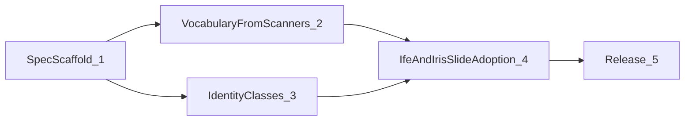

# Work Breakdown Structure

The tracking sheet for I2S's work, written top down: each **sprint** states
its purpose and the **milestone** that shows it done; each **task** states
what it achieves and the RTM rows it serves in brackets; the **steps** under
it are the checkable implementation, red first. Requirements live in
[RTM.md](RTM.md).

## Conventions

- **A sprint is one work package, one branch, one pull request.** It is sized
  to a few days *(estimate, not measured)*, ends in a milestone that can be run
  and seen, and closes with **VERIFY** (Ryan reviews) and **Gate** (CI green on
  the pull request). The branch is `feature/<SprintName>_<n>`.
  [README.md](README.md) gives the pull request's sections.
- **Red first.** A task's first step is the test shown failing, with its
  failure quoted; the task is ticked only with the green evidence and the
  commit that made it.
- **Status** after a sprint's name: `todo`, `ready` (its dependencies are
  merged), `doing`, `blocked` (with the reason), `done`.
- **One tick, one piece of evidence:** test counts and the command, a
  measurement, or a reviewed document; and the commit, once it exists.

## Sprint plan

| Sprint | Milestone (what is shown working) | Status |
|---|---|---|
| SpecScaffold_1 | `ctest` green on a header generated from `spec/*.json`; the generator refuses a removed key, a retyped key and a duplicate name | `doing` |
| VocabularyFromScanners_2 | the keys every scanner family writes at scan time (stain, scan date and time, optics, resolution) generated and tested, each DICOM mapping verified | `todo` |
| IdentityClasses_3 | every key's identity class decided by Ryan; no key left `UNDER_REVIEW` that a release depends on | `blocked` on Ryan's answers (Open questions) |
| IfeAndIrisSlideAdoption_4 | IFE's `METADATA_I2S` text points to I2S; Iris-Slide refuses an attribute key the generated header does not define | `todo` |
| Release_5 | a licence chosen, version 1.0 ratified, the repository public | `blocked` on the licence |

## SpecScaffold_1 — the specification compiles into C++ `doing`

Purpose: Ryan, 2026-11-24: "let's have I2S be a JSON specification that gets
compiled into C++ source like the IFE". Milestone: `cmake --preset debug &&
cmake --build --preset debug && ctest --preset debug` green on a header
generated at configure from `spec/*.json`, and `uv run pytest` showing the
generator refuse a removed key, a retyped key and a duplicate name. Branch
`feature/SpecScaffold_1`.

- [x] **ReadmeOnMain_1.1** — `README.md` on `main`: what I2S is, Ryan's words,
  draft and private. Commit 2e7f472
- [x] **KeySchema_1.2** — `spec/i2s_header.json` (version 0.1, draft,
  revisions) and `spec/i2s_keys.json` (value types, identity classes, keys,
  each grouped by version as IFE's spec is); seven keys seeded, each DICOM
  keyword, tag and VR read from PS3.6 2026e and the PS3.3 2026e modules on
  2026-11-24, the URLs recorded in each key's `verified` [Schema_01]. Commit 09cc501
- [x] **GeneratorGate_1.3** — `generator/` parses the JSON into frozen
  dataclasses, refusing unknown fields, unknown references, a name repeated in
  one JSON object or across version groups, and a short name equal to another
  key's name; the append-only gate compares the witness with
  `tests/witness/witness.json` [AppendOnly_01, UniqueNames_01]
  - [x] Red: `uv run pytest` before `generator/` existed: `ModuleNotFoundError:
    No module named 'generator'`
  - [x] Green: `uv run pytest`: 10 passed; `uv run mypy` (strict,
    `disallow_any_explicit`): no issues in 10 source files. Commit 09cc501
- [x] **GeneratedHeader_1.4** — `emit/cpp.py` writes `I2S_Keys.hpp`: scoped
  enumerations `Key`, `ValueType`, `IdentityClass`; the `constexpr` table
  `kKeys` indexed by `Key` (a `static_assert` holds the index); lookups
  returning `std::optional`. CMake's INTERFACE target `i2s` runs the generator
  at configure; Catch2 v3.16.1 pinned by archive hash [Generated_01,
  Generated_02, Generated_03]
  - [x] Red: built before CMake ran the generator: `keys_tests.cpp:5:10:
    fatal error: 'I2S_Keys.hpp' file not found`
  - [x] Green: `ctest --preset debug`: 6 of 6 passed. Commit 09cc501
- [x] **RenameBreaksBuild_1.5** — ctest builds `tests/cpp/renamed_key.cpp`,
  which names `I2S::Key::AccessionNumber`, and passes only when the compiler's
  error names it [Generated_04]
  - [x] Control: the same file naming `Key::Manufacturer` compiles, and the
    test fails: `Required regular expression not found`
  - [x] Green: `error: no member named 'AccessionNumber' in 'I2S::Key'`; test
    passed. Commit 09cc501
- [x] **PhiFlag_1.6** — `DigitalSlideIdentifierIsPHI` (`DSI_is_PHI`, BOOLEAN,
  identity `NONE`) and the key field `phi_flag` with `absent_means_phi`; the
  generator refuses a flag that names no key or a key that is not BOOLEAN; the
  generated `PhiFlag{Key::DigitalSlideIdentifierIsPHI, true}` carries the
  absent default [PhiFlag_01, PhiFlag_02]
  - [x] Red: `uv run pytest`: 3 failed, `unknown field(s) ['phi_flag']`; the
    C++ build: `error: no member named 'phi_flag' in 'I2S::KeyInfo'`
  - [x] Green: `uv run pytest`: 13 passed; `ctest --preset debug` and
    `--preset release`: 7 of 7 passed. Commit 09cc501
- [x] **GeneratedDocument_1.7** — `emit/docs.py` writes
  `generated_docs/i2s_specification.md` with the revision history, value
  types, identity classes, a key table and a section per key; byte-stable,
  checked by `test_generation_is_deterministic` [Document_01]. Commit 09cc501
- [x] **DevelopmentFolder_1.8** — this folder: README, WBS, RTM,
  `style_guide.md` (adapted from Iris-Slide's copy), `ci_runners.md`;
  `CONTRIBUTING.md` at the root [Process_01]
- [x] **CiWorkflow_1.9** — `.github/workflows/ci.yml` on Blacksmith's
  `blacksmith-2vcpu-ubuntu-2404` (Ryan, 2026-11-24: "We should be using
  blacksmith for our CI runners"): non-draft pull requests and by hand only,
  documentation-only changes skipped, 15-minute timeout, actions pinned by
  commit, uv and `dependencies/` cached [Ci_01]
  - [x] Rehearsed locally on macOS: the workflow's configure line, `--check`
    and `ctest --preset release` green. Not rehearsed in a Linux container
    *(to do on the first run)*; the image's CMake and Ninja are taken from
    GitHub's Ubuntu 24.04 image list (CMake 3.31.6, Ninja 1.13.2, read
    2026-11-24) on the assumption that Blacksmith's image matches it *(to
    confirm on the first run)*
- [ ] **VERIFY:** Ryan reads `spec/i2s_keys.json` and the generated header and
  answers the open questions
- [ ] **Gate:** CI green on the pull request

## VocabularyFromScanners_2 — the scan-time vocabulary `todo` · needs SpecScaffold_1

Purpose: Ryan's list, "acessioning number, stain info, time, date, scanner
info like unique device ID". Milestone: every key below that Ryan accepts is
in `spec/i2s_keys.json` with its DICOM mapping verified, generated and tested.
Nothing here is added until this sprint.

Keys the research of 2026-11-24 proposes (reports `dicom_wsi.md`,
`philips_3dhistech_roche_others.md`, `leica_aperio_hamamatsu.md`,
`identity_rules.md`; to be moved into this repository's `development/analysis/`
at the start of the sprint):

- **Stain and preparation** (coded, from DICOM's Specimen Preparation Sequence
  content items): staining substance (CID 8112), fixative (CID 8114),
  embedding medium (CID 8115), processing step (CID 8113). Only Olympus
  writes a stain at scan time; the other vendors' files carry none. Needs the
  value type `CODE` and a `code_sets` section, deferred from SpecScaffold_1.
- **Scan date and time:** `AcquisitionDateTime`, with the identity question
  below (dates other than the year are a HIPAA Safe Harbor identifier when
  "directly related to an individual").
- **Image geometry and resolution:** `ImagedVolumeWidth`, `ImagedVolumeHeight`,
  `ImagedVolumeDepth`, `TotalPixelMatrixColumns`, `TotalPixelMatrixRows`,
  `TotalPixelMatrixFocalPlanes`, `PixelSpacing` (microns per pixel),
  `NumberOfFocalPlanes`, `DistanceBetweenFocalPlanes`.
- **Focus and acquisition:** `FocusMethod`, `ExtendedDepthOfField`,
  `AcquisitionDuration`, scan mode, rack and slot position.
- **Optics:** `ObjectiveLensPower`, `ObjectiveLensNumericalAperture`,
  `IlluminationTypeCodeSequence`, illumination wavelength and colour.
- **Compression:** `LossyImageCompression`, its ratio and method.
- **Equipment:** firmware version, last calibration date and status (Philips
  only), `SpatialResolution`.
- **Container and specimen identity** (`ContainerIdentifier`,
  `SpecimenIdentifier`, `BarcodeValue`): the research classes them ambiguous,
  since a laboratory often derives them from the accession number; they go
  with the DSI question.

- [ ] **Analysis_2.1** — the research reports kept as written in
  `development/analysis/`
- [ ] **CodeSets_2.2** — the value type `CODE` and a `code_sets` section;
  red: a CODE key without a code set refused
- [ ] **ScanTimeKeys_2.3** — the keys Ryan accepts, each DICOM mapping
  verified with URL and date
- [ ] **VERIFY:** Ryan accepts the key list
- [ ] **Gate:** CI green on the pull request

## IdentityClasses_3 — every key's identity decided `blocked` · needs Ryan's answers

Purpose: a file's I2S attributes promise to identify no individual, so no key
can stay `UNDER_REVIEW` into a release. Milestone: no key a release depends
on is `UNDER_REVIEW`; each decision recorded with Ryan's words.

- [ ] **DsiIdentity_3.1** — Ryan answers Open question 1
- [ ] **DeviceIdentity_3.2** — Ryan answers Open question 2
- [ ] **PromiseAndFlag_3.3** — Ryan answers Open question 3; IFE's
  `METADATA_I2S` text changes with the answer (IfeAndIrisSlideAdoption_4)
- [ ] **VERIFY:** Ryan reviews the identity classes
- [ ] **Gate:** CI green on the pull request

## IfeAndIrisSlideAdoption_4 — the file format and the codec use I2S `todo` · needs VocabularyFromScanners_2, IdentityClasses_3

Purpose: I2S is the vocabulary IFE's `METADATA_I2S` names. Milestone: an
Iris-Slide encode refuses, by name, an attribute key that `I2S_Keys.hpp` does
not define, under `METADATA_I2S`.

- [ ] **IfeText_4.1** — IFE's `spec/ife_constants.json` `METADATA_I2S`
  description points to this specification and its version (a pull request
  on IFE)
- [ ] **IrisSlideAllowlist_4.2** — Iris-Slide consumes the `i2s` CMake target
  by FetchContent at a pinned commit and uses `I2S::key_from_name` as its
  attribute allowlist; red: an encode with a key I2S does not define is
  accepted
- [ ] **VERIFY:** Ryan encodes a slide and reads its attributes
- [ ] **Gate:** CI green on both pull requests

## Release_5 — public `blocked` · needs every sprint above and the licence

- [ ] **Licence_5.1** — Ryan chooses the licence (Open question 4)
- [ ] **Ratify_5.2** — version 1.0 ratified in `spec/i2s_header.json`; the
  witness frozen for 1.0
- [ ] **Publish_5.3** — Ryan makes the repository public
- [ ] **VERIFY / Gate**

## Decisions

| ID | Date | Decision | Ryan's words |
|---|---|---|---|
| Decision_01 | 2026-11-24 | I2S is a JSON specification compiled into C++ source, as IFE is | "let's have I2S be a JSON specification that gets compiled into C++ source like the IFE" |
| Decision_02 | 2026-11-24 | The accessioning number is the key `DigitalSlideIdentifier`, short name `DSI`; it has no DICOM keyword | "We'll call the accessioning number DigitalSlideIdentifier(DSI)" |
| Decision_03 | 2026-11-24 | The DSI has a companion BOOLEAN `DSI_is_PHI` (`DigitalSlideIdentifierIsPHI`) telling a de-identifier whether to scramble it | "We can add in the description that DSI has a separate DSI_is_PHI:bool so we know if it needs to be scrambled during deidentification" |
| Decision_04 | 2026-11-24 | Settled: when the DSI is present and `DSI_is_PHI` is absent, a reader and a de-identifier shall treat the DSI as PHI and scramble it (`absent_means_phi: true`, witnessed) | "Absent flag should default to true, scramble it" |
| Decision_05 | 2026-11-24 | CI runs on Blacksmith runners | "We should be using blacksmith for our CI runners" |

Judgment calls made in SpecScaffold_1, for Ryan's review:

- The identity class of `DeviceSerialNumber` and `UniqueDeviceIdentifier` is
  `UNDER_REVIEW`, against the brief that listed them as clearly identifying
  no person: `identity_rules.md` found DICOM PS3.15's Basic Profile removes
  both unless Retain Device Identity is used, and HIPAA Safe Harbor lists
  "Device identifiers and serial numbers" (Open question 2).
- The UDI key is named `UniqueDeviceIdentifier` after the DICOM keyword of
  the UDI Macro's attribute (0018,1009), with multiplicity `1-n` because
  DICOM's UDI Sequence holds one item per issuing agency.
- Only an identity class `UNDER_REVIEW` may change under the append-only
  gate; any other changed fact fails, and `--refresh-witness` refuses while
  one does.
- `CODE` and code sets wait for VocabularyFromScanners_2, where the stain
  vocabulary gives them a first user.
- Generated output is gitignored and regenerated at every configure, as in
  IFE; the generator runs at every configure (instead of IFE's run-when-missing
  option) because it rewrites only changed files.
- Catch2 is pinned by release archive and SHA-256 (IFE's tests use no
  framework, so there was no IFE pin to copy).
- The generated structs' public fields are plain (`info(key).short_name`)
  where the style guide asks `_leading_underscore` for data members: they are
  aggregate table rows read by consumers.

## Open questions

1. **Does an accession-derived DSI identify an individual?** The DSI's
   identity class is `UNDER_REVIEW`; `DSI_is_PHI` carries the answer per file.
   Research under way (`identity_rules.md` lays out options, without a
   recommendation).
2. **Do the scanner's serial number and UDI stay in I2S as identifying no
   individual?** (Judgment calls, above.)
3. **A file whose `DSI_is_PHI` is true carries PHI in its I2S attributes**,
   which contradicts IFE's promise that `METADATA_I2S` pairs identify no
   individual. Either the promise gains an exception for flagged keys, or a
   PHI DSI moves to the clinical metadata stream.
4. **Licence.** No LICENSE file until Ryan chooses; IFE's code is MIT.
5. **Several values in one attribute.** `SoftwareVersions` and
   `UniqueDeviceIdentifier` hold `1-n` values; how a file separates them in
   one attribute value (DICOM separates string values with a backslash) is
   for IfeAndIrisSlideAdoption_4.

## Session log

- 2026-11-24 — SpecScaffold_1: README on `main`; spec, generator, header,
  tests, document, this folder and CI on `feature/SpecScaffold_1`.
