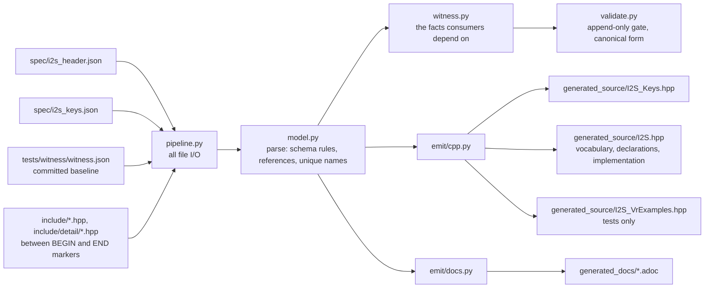

# generator/

Compiles `spec/i2s_header.json` and `spec/i2s_keys.json` into
`generated_source/I2S_Keys.hpp` (C++20, the vocabulary), stitches that
vocabulary with the hand-written sources in `include/` into
`generated_source/I2S.hpp` (the one installed header),
`generated_source/I2S_VrExamples.hpp` (each VR's example, for the tests
only; never installed), and the AsciiDoc includes in `generated_docs/` that `spec/i2s_spec.adoc` assembles
into the specification document. Standard-library Python 3.11+, so
CMake runs it with any interpreter; the development tools (mypy, pytest) are
managed by uv.

```bash
python3 -m generator                    # validate, then write both outputs
python3 -m generator --validate         # the linter: schema rules, canonical form, append-only gate; writes nothing
python3 -m generator --fix              # rewrite the spec files in canonical form, then validate
python3 -m generator --check            # CI: a stale witness, or an output the current spec and include/ sources do not produce, fails
python3 -m generator --refresh-witness  # record additions in tests/witness/witness.json
uv run pytest && uv run mypy            # the generator's tests and strict typing
```



| Module | Role |
|---|---|
| `__main__.py` | the command line; CMakeLists.txt calls `python -m generator -d <root>` |
| `pipeline.py` | loads the documents (refusing a name repeated inside one JSON object, which `json.loads` would drop silently), runs the gate, writes or checks outputs |
| `model.py` | `parse()` turns the JSON into frozen dataclasses or raises `SpecError` naming the file, the field and the offending value: names, DICOM tags and VRs, sources, dates, value-type examples, versions, consistency |
| `witness.py` | the witnessed facts and their sha256, which every generated banner carries |
| `validate.py` | the append-only gate (removed or changed facts fail, additions only under the current version) and the canonical form |
| `emit/cpp.py`, `emit/docs.py` | text only; `emit/cpp.py` names the sources `I2S.hpp` is stitched from (`SOURCES`), and `pipeline.py` reads them |

Output is byte-stable (no timestamps, document order), which
`tests/generator/test_validate.py::test_generation_is_deterministic` checks.
